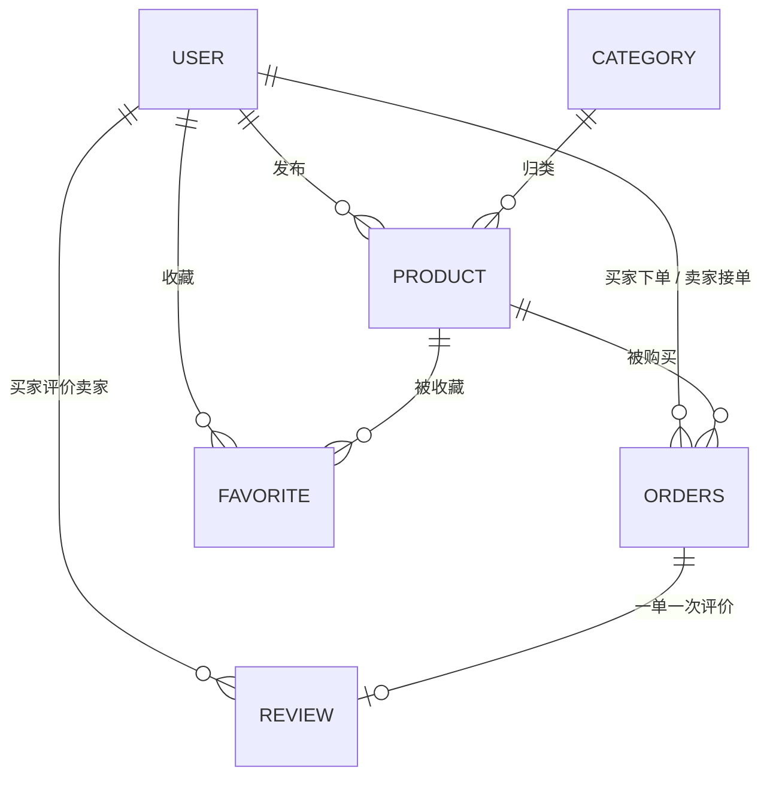

# CampusMart · 校园二手交易平台

> 一个从 0 到 1 手写后端的项目：不做花活，只把每个技术点真正落地一遍。

**40 个接口 · 6 张表 · 14 个前端页面 · 0 个未实现项**

## 项目亮点

| 维度 | 结果 | 怎么验的 |
|---|---|---|
| 接口 | **40 个，全部可用**（用户 / 分类 / 商品 / 订单 / 收藏 / 评价 / 管理端） | 全链路回归脚本 **66 项断言全过** |
| 并发 | 50 线程抢购 → **恰好 1 单**；20 线程共用一张幂等票 → **恰好 1 单**；10 线程评同一单 → **恰好 1 条** | [`scripts/concurrency_test.py`](scripts/concurrency_test.py) |
| 缓存 | 4000 次并发打详情页，命中率 **99.88%**，MySQL 实际只被查 **5 次** | Redis `info commandstats` + MySQL `Com_select` |
| 数据一致性 | 下单用乐观锁 + CAS 双保险，取消 / 超时 / 支付三方竞争后**状态唯一且自洽** | 并发脚本 C4b 组 |
| 交付质量 | `init.sql` 从零建库可反复执行（幂等 12 项）、配置无敏感信息入库（13 项） | [`scripts/verify_init_sql.py`](scripts/verify_init_sql.py)、[`verify_config.py`](scripts/verify_config.py) |
| 分层 | Controller 零业务零 try-catch，**实体不出入接口**（dto 进 / vo 出） | 全站 9 处出参改造 |

## 功能链路

```
注册登录 → 发布商品 → 浏览 / 搜索 → 收藏 → 下单（幂等票 + 乐观锁）→ 支付 → 发货 → 确认收货 → 评价
                                                      ↓
                                              15 分钟未付自动关闭，商品回滚到在售
```

管理员另有：商品强制下架（记录原因）、用户禁用 / 启用、含全状态的商品查询。

## 快速开始

**前置**：JDK 17+ ｜ Maven 3.9+ ｜ MySQL 8.x（本地 3306）｜ **Redis（本地 6379）**

### 方式一：一键启动（Windows）

```bat
start.bat
```

它会依次自检 5 项：配置文件是否存在 → Redis 是否在跑 → MySQL 是否在跑 → 库和表是否建好（没有就从 `sql/init.sql` 建）→ 启动应用。任一项不通过会明确告诉你缺什么，不会闷头报错。

### 方式二：手动 5 步

```bash
# 1. 建库建表（可反复执行，不会重复插入数据）
mysql -u root -p < sql/init.sql

# 2. 启动 Redis —— 商品详情接口依赖它，不启动会连接失败
redis-server                       # Mac / Linux
# Windows：双击 redis-server.exe，黑窗口关掉 = 服务停了
redis-cli ping                     # 返回 PONG 就对了

# 3. 生成配置文件
# Windows
copy src\main\resources\application.yml.example src\main\resources\application.yml
# Mac / Linux
cp src/main/resources/application.yml.example src/main/resources/application.yml

# 4. 启动（也可以在 IDEA 里直接运行 CampusMartApplication）
mvn spring-boot:run

# 5. 验证
curl http://localhost:8080/hello
```

配置文件里要改三项：

| 配置项 | 说明 |
|---|---|
| `spring.datasource.password` | 你的数据库密码 |
| `campusmart.jwt.secret` | 随机长字符串，至少 32 字符 |
| `campusmart.upload.path` | 上传文件存放目录，**结尾必须带 `/`**，目录不存在会自动创建 |

> ⚠️ `application.yml` 含数据库密码，已被 `.gitignore` 排除，**不会进入仓库**。
> 改了它一定要同步更新 `application.yml.example`，否则别人克隆后跑不起来。
> （`scripts/verify_config.py` 会自动比对这两个文件的键结构是否一致）

## 技术栈

### 后端

| 层次 | 选型 | 版本 |
|---|---|---|
| 语言 | Java | 17 |
| 框架 | Spring Boot | 4.1.1 |
| 持久层 | MyBatis-Plus | 3.5.17（`spring-boot4-starter` + `jsqlparser`） |
| 数据库 | MySQL | 8.x |
| 缓存 | Redis（`StringRedisTemplate`） | 本地 5.0.14 |
| 认证 | JWT（jjwt） | 0.12.6 |
| 密码加密 | Spring Security Crypto（BCrypt） | — |
| 参数校验 | spring-boot-starter-validation | — |
| 构建 | Maven | 3.9+ |

### 前端

React 19.1 + TypeScript 5.8 + Vite 7.1 + Tailwind CSS 4.3

## 分层结构

```
com.itcjj.campusmart
├── controller     接口层：接参、调 service、返回统一响应
├── service        业务层：业务规则、事务边界
│   └── impl
├── mapper         持久层：MyBatis-Plus Mapper
├── entity         数据库实体（与表一一对应，**不出入接口**）
├── dto            入参对象
├── vo             出参对象
├── enums          状态枚举（`OrderStatus`）
├── task           定时任务（超时关单）
├── common         统一响应、错误码、缓存 key
└── exception      业务异常 + 全局异常处理器
```

约定：

- Controller **零业务逻辑、零 try-catch**；Service 只抛 `BizException`
- **dto 进、vo 出、实体不出接口** —— 避免 `deleted` / `version` / `tokenVersion` 这类内部字段泄漏给前端
- 统一响应体 `{ "code": 0, "msg": "ok", "data": ... }`，`code = 0` 表示成功
- ⚠️ **HTTP 状态码恒为 200**，错误只体现在响应体的 `code` 里

## 数据库设计

六张表：`user` / `category` / `product` / `orders` / `favorite` / `review`



完整字段定义见 [`docs/er-diagram.md`](docs/er-diagram.md)，建表语句见 [`sql/init.sql`](sql/init.sql)。

**商品状态**（`product.status`）：

| 值 | 含义 | 谁会写 |
|---|---|---|
| `1` | 在售 | 发布 / 重新上架 / 订单取消回滚 |
| `2` | 已售出（下单即锁定） | 下单时 CAS `1 → 2` |
| `0` | 卖家下架 | 卖家主动下架 |
| `3` | 平台强制下架 | 管理员下架，**带 `offline_reason`** |

**订单状态**（`orders.status`）：`0` 待付款 → `1` 已付款 → `2` 已发货 → `3` 已完成；`4` 已取消（待付款 / 已付款都可取消）

三个刻意的建模决策：

- ⚠️ **没有 `order_item` 明细表**：校园二手每件商品都是孤品（一单一品），商品标题 / 图片 / 金额**快照直接内联在 `orders` 表**。这是决策，不是省略。
- ⚠️ **不设 `stock` 字段**：没有「数量」这回事。防超卖 = 下单时把 `product.status` 从 `1` 改成 `2`，配合乐观锁。
- ⚠️ **金额一律 `DECIMAL(10,2)`**，绝不 `float` / `double`。校验上限必须跟着列定义走（`@Digits(integer = 8, fraction = 2)`），否则越界值会在入库那一刻炸成 500。

## 接口总览

共 **40 个**。完整请求/响应示例见 [`docs/api.md`](docs/api.md)。

> ⚠️ 白名单**只有** `/user/login`、`/user/register`、`/error`，其余接口全部需要 `Authorization: Bearer <token>`。
> 静态资源 `/upload/**` 免登录（靠拦截器里「不是 HandlerMethod 直接放行」实现）。

### 用户（9）

| 方法 | 路径 | 说明 | 权限 |
|---|---|---|---|
| POST | `/user/register` | 注册（用户名唯一） | 公开 |
| POST | `/user/login` | 登录，返回 JWT | 公开 |
| GET | `/user/me` | 当前登录用户 | 需登录 |
| PUT | `/user/password` | 改密码（`token_version + 1`，旧 token 全失效） | 需登录 |
| POST | `/user/avatar` | 上传头像 | 需登录 |
| PUT | `/user/update` | 改资料（只更新传入字段） | 本人或 ADMIN |
| POST | `/user/add` | 新增用户 | 需登录 |
| GET | `/user/list` | 用户列表 | **ADMIN** |
| DELETE | `/user/delete/{id}` | 删除用户（逻辑删除） | **ADMIN** |

### 分类（1）

| 方法 | 路径 | 说明 | 权限 |
|---|---|---|---|
| GET | `/category/list` | 全部分类 | 需登录 |

### 商品（11）

| 方法 | 路径 | 说明 | 权限 |
|---|---|---|---|
| POST | `/product/publish` | 发布（卖家从 token 取，**不信前端**） | 需登录 |
| PUT | `/product/update` | 编辑（校验归属权，且商品须在售） | 仅卖家 |
| PUT | `/product/offline/{id}` | 卖家下架 → `0` | 仅卖家 |
| DELETE | `/product/delete/{id}` | 逻辑删除 | 仅卖家 |
| PUT | `/product/relist/{id}` | 重新上架（**仅** `0 → 1`） | 仅卖家 |
| GET | `/product/list?categoryId=` | 按分类查在售 | 需登录 |
| GET | `/product/search` | 关键字 + 价格区间 + 成色 + 排序 + 分页 | 需登录 |
| GET | `/product/{id}` | 详情（**Redis 缓存 + 缓存分层**） | 需登录 |
| GET | `/product/mine` | 我发布的（含 `0/1/2/3` 全状态，分页） | 需登录 |
| GET | `/product/history` | 我的浏览历史（Redis ZSet，最近 20 条） | 需登录 |
| POST | `/product/images` | 多图上传（≤ 9 张，每张 ≤ 2MB） | 需登录 |

### 订单（9）

| 方法 | 路径 | 说明 | 权限 |
|---|---|---|---|
| GET | `/order/token` | 领幂等票（UUID，Redis TTL 5min，**只能用一次**） | 需登录 |
| POST | `/order/create` | 下单（校验商品 + 快照 + 事务 + 乐观锁） | 需登录 |
| PUT | `/order/pay/{orderId}` | 支付（模拟） | 买家 |
| PUT | `/order/ship/{orderId}` | 发货 | 卖家 |
| PUT | `/order/confirm/{orderId}` | 确认收货 | 买家 |
| PUT | `/order/cancel/{orderId}` | 取消（回滚商品到在售） | 买家或卖家 |
| GET | `/order/bought` | 我买的（按状态筛选，分页） | 需登录 |
| GET | `/order/sold` | 我卖的（按状态筛选，分页） | 需登录 |
| GET | `/order/{orderId}` | 订单详情 | **仅买卖双方** |

### 收藏（3）

| 方法 | 路径 | 说明 | 权限 |
|---|---|---|---|
| POST | `/favorite/{productId}` | 收藏 | 需登录 |
| DELETE | `/favorite/{productId}` | 取消收藏（**幂等**，删 0 行也算成功） | 需登录 |
| GET | `/favorite/list` | 我的收藏 | 需登录 |

### 评价（2）

| 方法 | 路径 | 说明 | 权限 |
|---|---|---|---|
| POST | `/review/{orderId}` | 提交评价（订单须「已完成」，一单一评） | **仅买家** |
| GET | `/review/seller/{sellerId}` | 卖家评价（分页 + 平均分 + 总数） | 需登录 |

### 管理端（4）

| 方法 | 路径 | 说明 | 权限 |
|---|---|---|---|
| GET | `/admin/product/search` | 商品查询（含 `0/1/2/3`，可按状态/关键字/分类筛选，分页） | **ADMIN** |
| PUT | `/admin/product/offline/{id}` | 平台强制下架，记录原因 | **ADMIN** |
| PUT | `/admin/user/disable/{id}` | 禁用用户（`status=0` **且** `token_version + 1`） | **ADMIN** |
| PUT | `/admin/user/enable/{id}` | 启用用户 | **ADMIN** |

另：`GET /hello` 连通性测试（需登录）。

## 关键设计

### 1. 并发控制：四种原子手段

问题不是一个「防重复提交」能盖住的，按场景分：

| 场景 | 手段 | 原理 |
|---|---|---|
| 用户连点两下「下单」 | **幂等 Token** | `GET /order/token` 发一张 UUID 票，`Redis.delete` 返回 `true` 才算抢到票 —— 删除本身是原子的，天然「撕票」 |
| 两笔订单抢同一件商品 | **乐观锁 `@Version`** | `UPDATE product SET status=2, version=version+1 WHERE id=? AND version=旧值`，`rows==0` 表示被别人抢先 |
| 同一订单两个操作同时到（支付 vs 超时关闭） | **CAS 条件更新** | `UPDATE orders SET status=4 WHERE id=? AND status=0`，状态再写一遍在 `WHERE` 里 |
| 同一订单被评两次 | **UNIQUE 索引兜底** | `uk_order_id (order_id)`，就算前面判重漏了，数据库也拦得住 |

另外两处「靠数据库自己算，不用先读后写」：

- `token_version = token_version + 1` —— 禁用用户 / 改密码时，不读旧值直接自增
- `view_count = view_count + 1` —— 浏览量同理，避免并发下丢计数

> 实测（[`scripts/concurrency_test.py`](scripts/concurrency_test.py)）：
> 50 线程抢购 → 恰好 1 单其余 `2003`；20 线程共用一张票 → 恰好 1 次其余 `2005`；
> 10 线程评同一单 → 1 条其余 `2012`；超时关闭与支付竞争 → 结果唯一且自洽。

### 2. 商品详情缓存分层

```
GET /product/{id}
  ↓ ① get("product:detail:{id}")
    ├─ 有值    → 反序列化直接返回（不碰数据库）
    ├─ 空串 "" → 上次查过确实没有 → 直接返回 2001（防穿透）
    └─ null    → 没缓存过，继续 ↓
  ↓ ② selectById(id)
    ├─ 查到 → 写回 Redis（TTL 30min）→ 返回
    └─ 没有 → 写空值标记 ""（TTL 1min）→ 返回 2001
```

分层逻辑：**不是所有字段都值得缓存**。

| 数据 | 缓存 | TTL | 判据 |
|---|---|---|---|
| 商品本体（标题/价格/状态） | `product:detail:{id}` | 30 min | 读得多、写得少、算得贵 |
| 卖家昵称/校区/评分 | `user:brief:{id}` | 60 s | 会变（评价一多分数就变），单独短 TTL |
| 浏览量 `view_count` | **不进缓存** | — | 每次都变的数字，缓存只会带来不一致 |

其他要点：

- **Redis 存不了 `null`**，用空串 `""` 代表「这个 id 确实不存在」
- **Cache Aside**：改 / 下架 / 删商品时 `delete` 缓存，顺序是**先更新数据库，再删缓存**（反了会被读请求用旧值回填）
- Redis key 与 TTL 全部集中在 [`CacheKeys`](src/main/java/com/itcjj/campusmart/common/CacheKeys.java) —— key 拼法若有两个出处，「写的地方改了删的地方忘了」，缓存会**静默失效且不报错**

### 3. 权限与越权防护

- 登录签发 **JWT**，之后带 `Authorization: Bearer <token>`
- 拦截器校验顺序：签名 → 过期 → **token 版本号** → 接口权限注解
- `token_version` 机制：改密码 / 禁用用户时版本 +1，**该用户所有已签发 token 立即失效**（解决无状态 JWT 无法撤销的固有问题）
- 自定义注解 `@RequireAdmin` + 拦截器读方法注解做接口级鉴权
- 状态码语义：**401 = 未登录 / 403 = 已登录但权限不够**，前端分开处理
- **IDOR 原则**：每个带 id 的写接口都要问一句「这个 id 凭什么是你能操作的」
  - 改 / 下架 / 删商品 → 校验 `seller_id`
  - 订单详情 → 仅买卖双方
  - 评价 → 仅买家
  - 改他人资料 → 仅 ADMIN

| 安全项 | 做法 |
|---|---|
| 密码存储 | BCrypt（随机盐 + 慢哈希 + 可调 cost），库里不存明文 |
| 登录失败提示 | 统一「用户名或密码错误」，**不区分**用户不存在 / 密码错，防账号枚举 |
| 入参校验 | Bean Validation + 校验分组 + 自定义注解 `@Phone`；成对写 `@NotNull` 与其他约束（其他约束遇 `null` 一律放行） |
| 文件上传 | UUID 重命名防路径穿越、扩展名白名单、**文件头魔数校验**、大小上限 |
| 敏感信息 | 密码 / token 不进日志；手机号只出现在 `OrderDetailVO.counterparty.phone` |
| 日志分级 | 关键动作 `info`、业务分支 `warn`、真正的意外 `error`（带堆栈）；列表查询不打 |

### 4. 错误码

HTTP 状态码恒为 200，业务结果看 `code`：

| code | 含义 | 典型场景 |
|---|---|---|
| `0` | ok | 成功 |
| `400` | 参数不合法（提示语动态返回） | 校验失败 / 缺参数 / 类型不对 / 上传超限 |
| `401` | 请先登录 | 没带 token、token 无效 / 过期 / **已被撤销** |
| `403` | 无权限访问 | 普通用户打管理员接口、操作他人资源 |
| `404` | 接口不存在 | 访问了没有的路径 |
| `1001` | 用户名已存在 | 注册 / 新增用户 |
| `1002` | 用户不存在 | 更新 / 删除 / 禁用不存在的用户 |
| `1003` | 用户名或密码错误 | 登录失败 |
| `1004` | 原密码错误 | 改密码 |
| `1005` | 上传文件不能为空 | 上传 |
| `1006` | 图片格式不支持 | jpg / jpeg / png / gif / webp 之外 |
| `1007` | 文件上传失败 | 落盘 IO 异常 |
| `2001` | 商品不存在 | 查询 / 编辑 / 下架 / 删除；**也是缓存空值的落点** |
| `2002` | 最多上传 9 张图片 | 多图上传越界 |
| `2003` | 商品已售出或已下架 | 下单 / 编辑 / 下架时的状态冲突 |
| `2004` | 不能购买自己的商品 | 下单 |
| `2005` | 请勿重复提交 | 幂等票已被撕 |
| `2006` | 订单不存在 | 订单操作 |
| `2007` | 当前订单状态不允许该操作 | 非法流转（如未付款就发货） |
| `2008` | 已收藏 | 重复收藏 |
| `2009` | 已取消收藏 | 重复取消 |
| `2010` | 商品正在交易中 | 有进行中订单时编辑 / 下架 |
| `2011` | 订单未完成 | 提前评价 |
| `2012` | 已评价 | 一单一评 |
| `2013` | 商品当前状态不允许重新上架 | 只有 `0 → 1` 可以 |
| `2014` | 商品已售出，不能下架 | 管理员下架已售出商品 |
| `2015` | 用户已禁用 | 禁用用户尝试登录 / 操作 |
| `2016` | 分类不存在 | 发布 / 编辑商品时分类 id 无效 |

所有异常由 [`GlobalExceptionHandler`](src/main/java/com/itcjj/campusmart/exception/GlobalExceptionHandler.java) 统一转换，**Controller 层不写 try-catch**。

⚠️ 关键点：Spring 挑 handler 是「**最具体优先**」。框架异常（缺参数、类型不对、路径不存在、上传超限、数据不满足数据库约束）如果没人认领，会落进最后的 `Exception` 兜底变成 500 —— 明明是调用方传错了参数，却报「服务器开小差了」。所以这些必须各自挂一个 handler 转成 400 / 404。

## 测试与验证

仓库内四套脚本，**只用 Python 标准库，无需 `pip install`**，成功退出码 0、有失败项非 0：

```bash
python scripts/e2e_full_flow.py      # 全链路：8 个环节 66 项断言
python scripts/concurrency_test.py   # 并发：6 组证据（含两次 40 秒等待，约 90 秒）
python scripts/verify_init_sql.py    # init.sql 从零建库 + 幂等 + 与真库 DDL 比对
python scripts/verify_config.py      # yml 与示例键结构一致 + 敏感信息未入库
```

详见 [`scripts/README.md`](scripts/README.md)。接口用例清单见 [`docs/test-cases.md`](docs/test-cases.md)。

## 前端

`web/` 目录是独立的 React 前端（14 个页面），覆盖买家 / 卖家 / 管理员三条视图。

```bash
cd web
npm install
npm run dev -- --host 127.0.0.1 --port 5199
```

> ⚠️ Windows 上不加 `--host 127.0.0.1`，Vite 默认绑 IPv6 回环（`::1`），用 `127.0.0.1` 访问会连不上。

后端返回的时间字段是 ISO 8601（`"2026-10-15T09:03:26"`），前端直接 `new Date()` 即可解析；
金额字段是数字类型（`2999.0` 而不是 `"2999.00"`），展示时自行 `toFixed(2)`。

## 开发进度

### Phase 1 · Java 后端基础

- [x] **Week 00 · 起手**（9.10 ~ 9.13）
  - Java 异常 / IO / Jackson、集合框架（HashMap 底层、泛型擦除）、并发基础（synchronized / volatile / 线程池）
  - 仓库初始化 + ER 图设计 + `.gitignore` + 提交规范
  - Spring Boot 骨架 + MySQL + MyBatis-Plus（逻辑删除、时间自动填充）
  - 用户模块 CRUD 跑通
- [x] **Week 01 · 用户认证**（9.14 ~ 9.20）
  - 分层规范 + `Result<T>` 统一响应 + `CodeEnum` + 全局异常
  - JWT 签发 / 解析 + 注册登录；登录失败不泄漏用户名是否存在
  - 拦截器 + `ThreadLocal` 用户上下文（`afterCompletion` 统一清理）
  - Bean Validation + **校验分组** + 自定义注解 `@Phone`
  - BCrypt 加密 + **`token_version` 撤销机制** + 头像上传三件套
  - 43 条接口自测集合，发现并修复 4 个问题
- [x] **Week 02 · 商品模块**（9.21 ~ 10.08）
  - `category` / `product` 表 + 发布 / 编辑 / 下架 / 删除（每个都校验归属权）
  - `LambdaQueryWrapper` 多条件搜索 + 分页插件（补引 `mybatis-plus-jsqlparser`）+ 排序白名单
  - 多图上传（抽 `FileStorageService`，与头像共用）
  - Redis 缓存 + **空值防穿透** + Cache Aside 一致性 + 4000 次压测

### Phase 2 · 业务开发

- [x] **Week 03 · 订单与并发**（10.09 ~ 10.13）
  - `orders` 表设计 + 一单一品（不建明细表）+ `OrderStatus` 状态枚举
  - 创建订单（商品校验 + 快照 + 事务回滚验证）；**乐观锁修复并发超卖**（50 线程 → 1 单）
  - **幂等 Token** 防重复提交（20 线程共用一票 → 1 单）
  - 订单流转四接口（支付 / 发货 / 确认收货 / 取消回滚商品）
  - 收藏三接口 + 浏览历史（Redis ZSet，同商品看两次仍一条且置顶）
  - 交易中商品保护 + `orders.product_id` 索引（`EXPLAIN` 验证）
  - 未付款超时关闭（`@Scheduled` + CAS + 商品回滚）
  - 我的发布 / 重新上架（CAS `0 → 1`）/ 订单列表与详情（新建 `vo` 包）
- [x] **Week 04 · 评价 / 管理端 / 交付**（10.13 ~ 10.25）
  - 评价模块（一单一评，UNIQUE 兜底）+ 卖家评价查询（分页 + 平均分）
  - 用户禁用 / 启用（`token_version + 1`，旧 token 立即失效）
  - 管理端商品查询（含全状态）+ 平台强制下架（`offline_reason`，边界分级 `2014 / 2010 / 2003`）
  - 缓存分层（`user:brief` 短 TTL）+ `ProductDetailVO` 不该缓存的字段单独处理
  - **技术欠债清理**：实体不出接口（全站 9 处）、全局异常补 5 个 handler、统一分页校验、`view_count` 原子自增
  - 测试体系：全链路回归（66 断言）+ 并发证据（6 组）+ `init.sql` 幂等校验 + 配置校验 + 一键启动脚本
  - 前端 14 个页面（React 19 + Vite 7 + TS + Tailwind 4）真机走查

### Phase 3 · 交付

- [x] README / ER 图 / 接口文档 / 错误码表同步
- [x] `v1.0` tag
- [ ] 3 分钟演示录屏

## 提交规范

采用 [Conventional Commits](https://www.conventionalcommits.org/)：

```
<type>(<scope>): <subject>
```

| type | 含义 |
|---|---|
| feat | 新功能 |
| fix | 修 bug |
| docs | 文档 |
| refactor | 重构（不改行为） |
| test | 测试 |
| chore | 构建 / 依赖 / 配置 |
| style | 格式（不影响逻辑） |

```
feat(order): 下单接口接入幂等 Token，防止重复提交
fix(order): 商品接入乐观锁，修复并发下单超卖
docs(readme): 补充 ER 图说明
```
